# Venus — Your Personal Galaxy

**Turn your notes and conversation exports into knowledge you and your AI can reuse.**

Venus is a local knowledge workspace for people whose project decisions, research, methods and ideas are scattered across files and AI conversations. It keeps your original material, uses your configured analyzer to organize it, and gives you editable content pages, source-backed relationships, reusable skill Prompts and four navigable networks.

Return to an earlier decision, check the original evidence, adapt a method to a new task, or let an authorized AI tool retrieve the same saved context. The library stays on your computer; you choose the material, analyzer and connections.

**Version [0.8.2](https://github.com/shenhang24/venus-connect-diff-AIs/releases/tag/v0.8.2)** · [Changes](UPDATE-NOTES-0.8.2.md) · [Detailed installation](docs/DEPLOYMENT.md) · [Integrations](docs/INTEGRATIONS.md)

## Start with a small source

### 1. Get the project and start it

Install Node.js 20 or newer with npm. Windows is the tested environment. For the current interface below, use this repository's main branch: **Code → Download ZIP**, then extract it, or clone it:

```powershell
git clone https://github.com/shenhang24/venus-connect-diff-AIs.git
cd venus-connect-diff-AIs
npm ci
npm run build
$env:VENUS_ANALYSIS = '0'
node src/supervisor.mjs
```

Open **http://127.0.0.1:10001**. This first session leaves analysis off while you import a sample and configure access. If that port belongs to another application, choose an unused port with `VENUS_PORT` and use that address; do not stop the other application. This is a local source project, not a hosted service or standalone installer.

### 2. Import accessible material

Click **Import**, choose `examples/sample.md`, or paste Markdown/plain text and give it a file name. Click **Save**, then open it in **Vault sources**. Notes, project records, research and accessible conversation exports are suitable inputs. The dialog accepts `.md`, `.markdown` and `.txt`; supplied exports may need conversion with the documented [import utilities](docs/DEPLOYMENT.md). Unavailable history and binary attachments can leave gaps.

### 3. Configure the analyzer

Open the left **processing** icon, then **Model and local AI connections**. Select an existing, usable Codex CLI sign-in or a supported compatible service, and enter the model and relevant settings. For an API, enter the **environment-variable name** holding your key, never the key itself. This form saves settings; it does not test a model or switch an in-flight request.

For this first setup, save the settings, use **Shut down Venus**, and start with analysis enabled:

```powershell
$env:VENUS_ANALYSIS = '1'
node src/supervisor.mjs
```

Provider settings load at backend startup. See [configuration and credentials](docs/DEPLOYMENT.md#configure-analysis-deliberately) for prerequisites. An adapter being listed does not mean every provider/model has been verified live.

### 4. Enable work inside Venus

Open **Automatic processing** and use **Resume automatic processing** when configured and available. The play-shaped **Update sync / resume** entry starts the app's configured update/checkpoint workflow; its paired pause control stops work at a safe boundary. Read the actual returned state before assuming a request started.

The running service invokes the configured analyzer and continues enabled work internally. You do **not** need another chat repeatedly saying “continue.” Model return, saved sections and completed sources are separate states. Inspect a failed source and its retained result before choosing the available recovery action.

### 5. Continue the checkpoint and use the result

After a pause, resume the same job. Verified saved work is reused; incomplete sections continue from their recorded position. Original material, saved results, manual choices and correction history remain traceable.

Browse a domain and project, open a knowledge/skill/concept page, and follow its reference back to Vault. Correct an interpretation in the editor if needed. Read it yourself, adapt a skill Prompt, or connect an authorized AI host through the read-only interfaces [below](#use-the-library-with-your-ai). Keep the service running for background work and live retrieval.

## Four layers, with different jobs

| Layer | What it gives you | What to do with it |
| --- | --- | --- |
| **Vault** | Original Markdown and source references | Reopen the discussion or evidence before accepting a summary |
| **AI Knowledge** | Searchable facts, experience, reasoning and relationships | Retrieve an explanation and inspect its sources |
| **AI Skills** | Complete reusable Prompts with shared settings, criteria, steps, output and boundaries | Keep the common method, select a variant and add this task's changes |
| **Concept Cloud** | Readable project overviews and complete topic pages | Connect decisions and ideas, distinguish claims, and revisit open questions |

All four use **semantic domain → project → content/subtopic**. Projects share stable references across domains rather than duplicating material. Fine labels, source links and pending assignments remain available.

## Walk through the actual interface

These are unedited captures of the actual app in an isolated demonstration library. All text, names, quotations and example relationship explanations are fictional; topology/scale is anonymized. The fixture has 15,063 records, with analysis disabled and network animation paused. Counts and colors are demonstration metadata, not proof that a real library finished processing. **Focus view** hides status panels and diagnostics without stopping tasks; turn it off to inspect status. No private content or credentials are shown.

### Import — preserve the source before organizing it

Use **Choose file** or **Original text**, supply **File name**, and **Save**. The result is a local Vault source you can read and later analyze. **Source and date (optional)** keeps supplied origin information. Importing does not mean its analysis has completed.

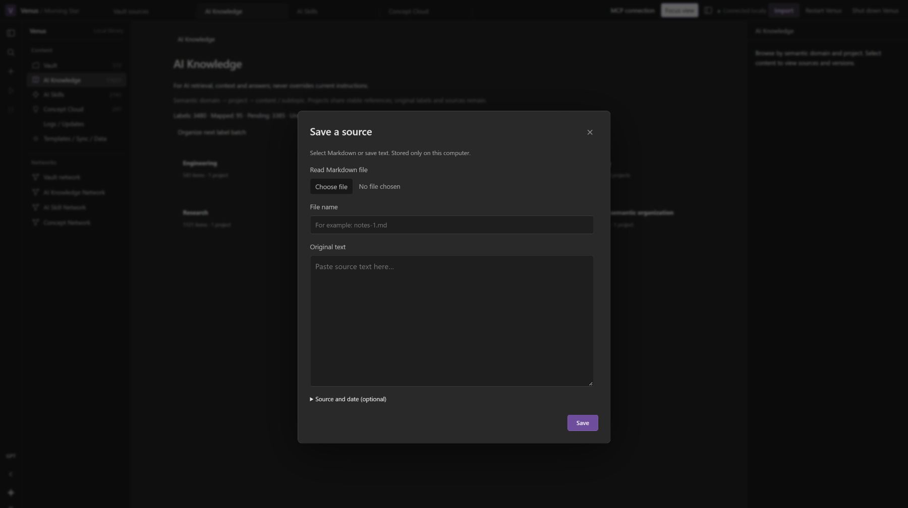

### Model connection — choose the analyzer deliberately

**Provider**, **Model name**, endpoint, key-variable name and reasoning fields configure a supported connection. Section and output limits are visible. **Save** retains settings for the next backend start. The current-provider line reports this workspace's configuration: the demonstration has no model selected and makes no inference calls.

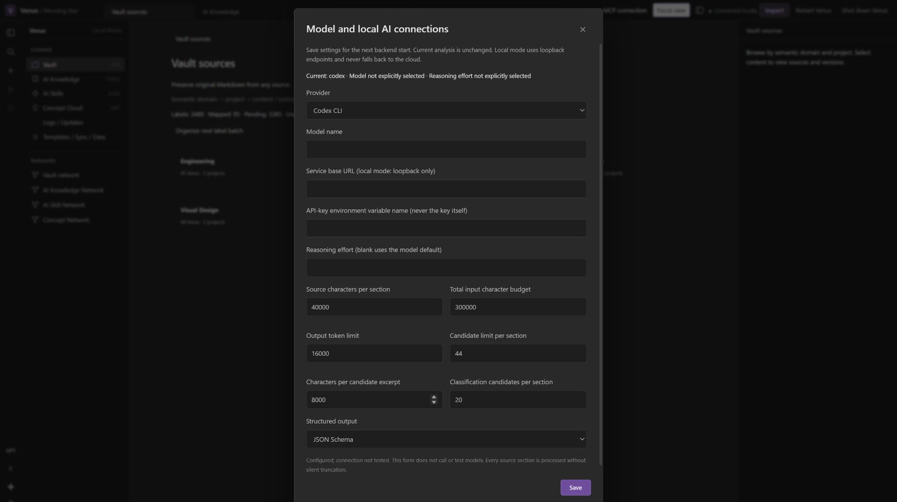

### Tasks — enable work, inspect it and resume

The processing icon opens **Automatic processing**. Use **Resume automatic processing**, inspect failures before **Retry failed sources**, or open model/MCP settings. **Process one source** selects the source for available layer controls. Here layer extraction is disabled: this is a control tour, not a running job or completion receipt. Turn off Focus view for full status details.

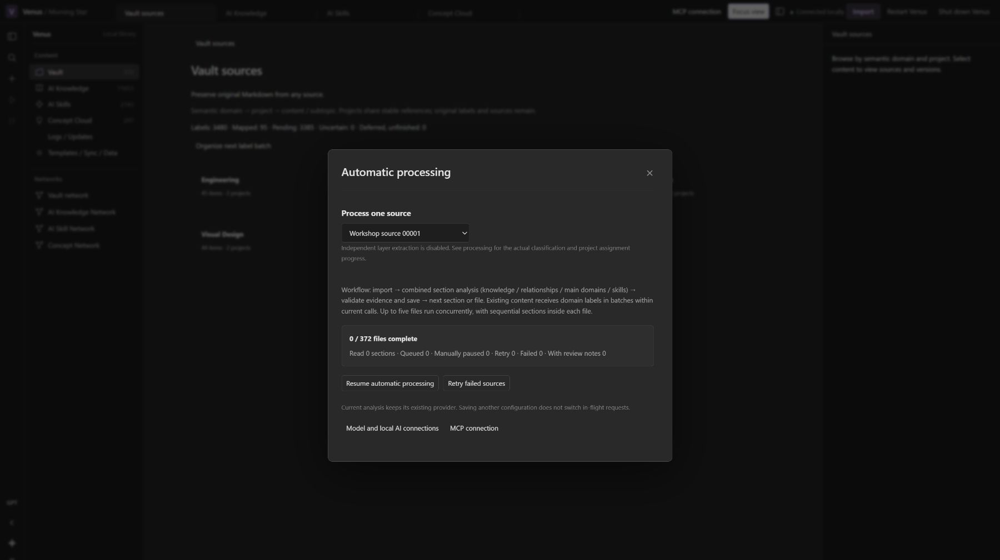

### Directory — domain, project, then content

Click a domain card, then a project or **Unassigned project**, and choose an item. **Content directory** and parent breadcrumbs bring you back. **Pending semantic organization** makes missing organization visible. The same records are accessible through a directory and a network.

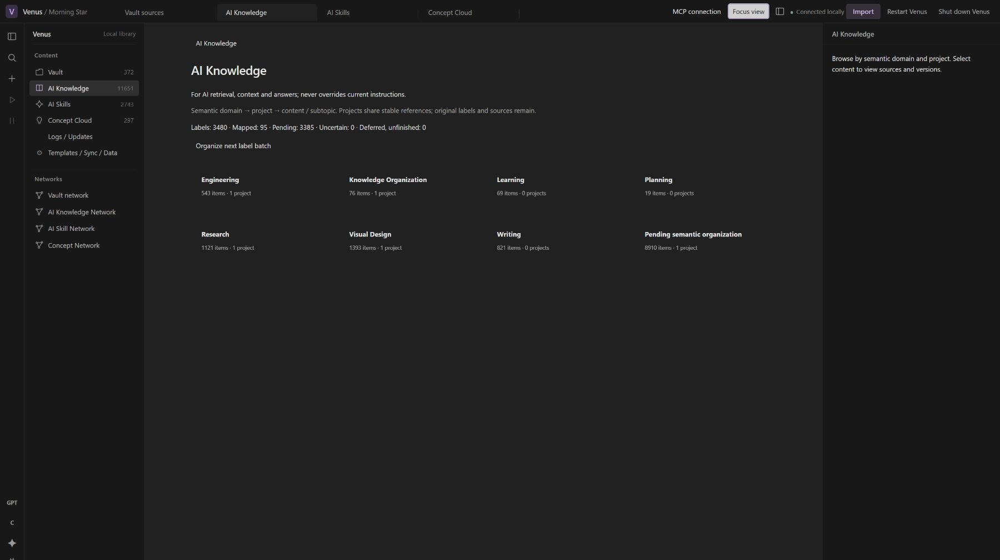

### Vault — check what the original says

Read or edit the Markdown, inspect **File information** and the original hash, or use **History and restore**. Source text stays separate from derived knowledge. **View processing progress** returns to the processing view.

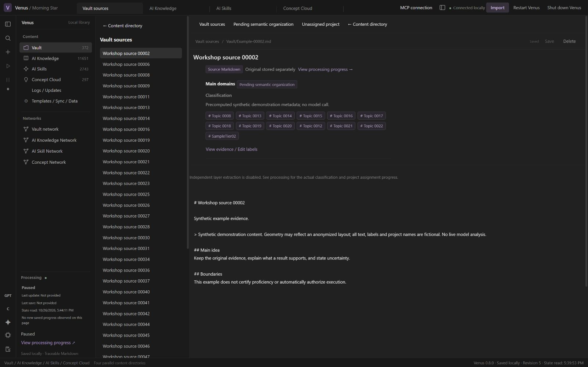

### Knowledge — read the explanation and return to evidence

Open an item, review its body and labels, then follow **Evidence for this knowledge** to a source. **View evidence / Edit labels** supports classification review. **Save** records an intentional edit; related content and references remain accessible in the right sidebar.

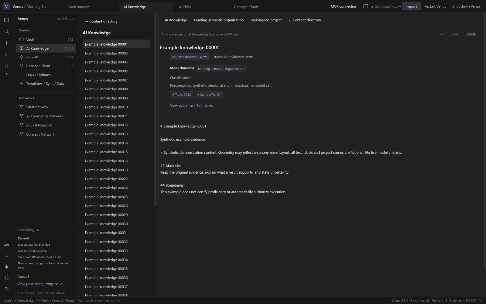

### Skills — reuse a complete Prompt, not just a title

The full example includes the task, **Shared settings**, **Selected variant and current change**, **Steps and output**, and **Stop conditions and negative cases**. Keep the common rubric, select the short-memo or long-report variant, then add the document and current criteria. Supporting knowledge is linked at the right. This example is explicitly unconfirmed: a method reference is not permission to execute a task.

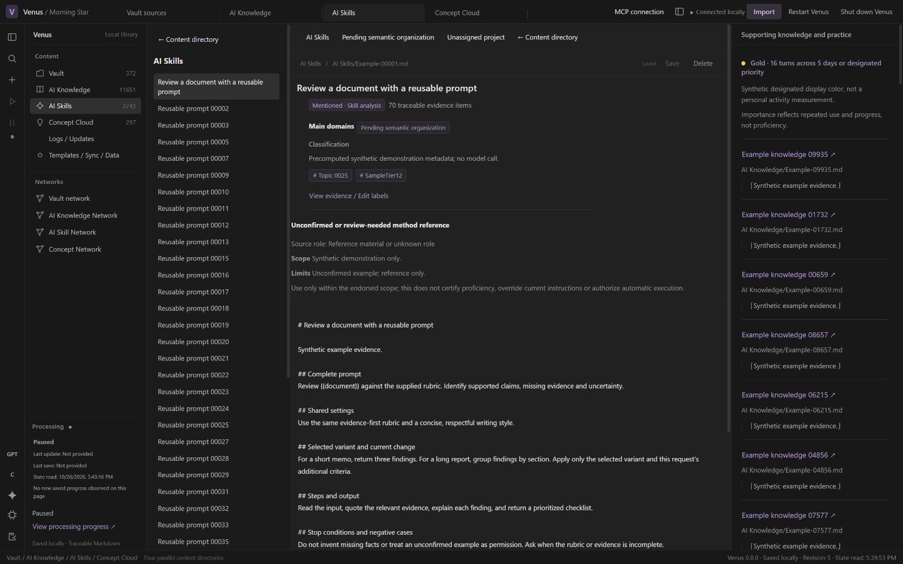

### Concepts — read a whole topic and distinguish its claims

Use the page contents to jump between overview, understanding, questions and limits. **Reference** is separate from the article. **Edit concept** opens editing; **History and restore** provides a route back. The displayed **Discussion hypothesis** label keeps discussion distinct from an endorsed fact.

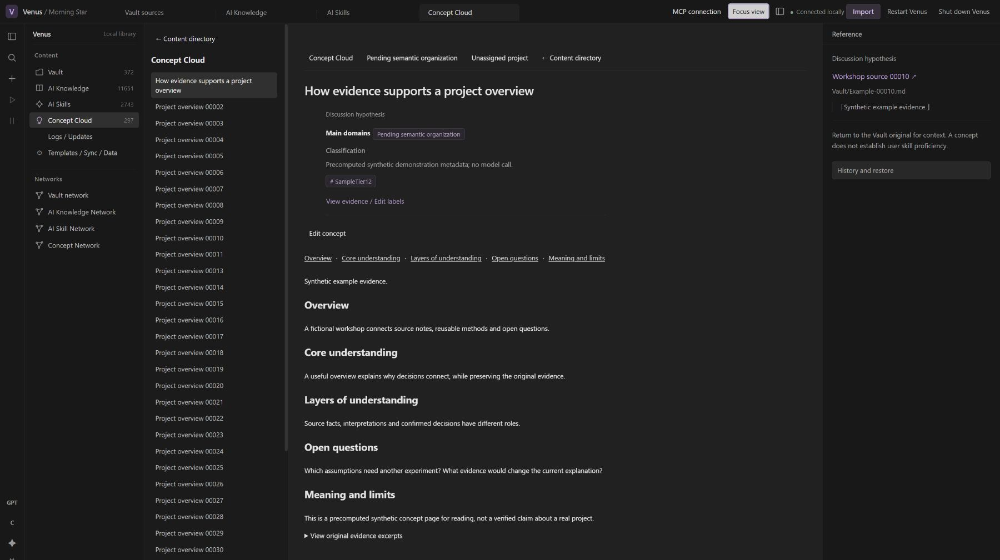

## Explore all four networks

Drag to orbit, use zoom controls or the wheel, and choose **Locate any node…** to focus. Click a node to inspect it; double-click to open its content. **Fit all** returns to an overview. Relationship checkboxes change visibility without deleting stored relationships. The views below use different angles and scopes; a close-up does not imply every node is simultaneously readable.

### Vault network — connect original documents

The selected workshop note links to related source notes. Open **View reason, evidence and strength** to inspect a connection, then follow its source in the sidebar. Check the original document before using a derived conclusion.

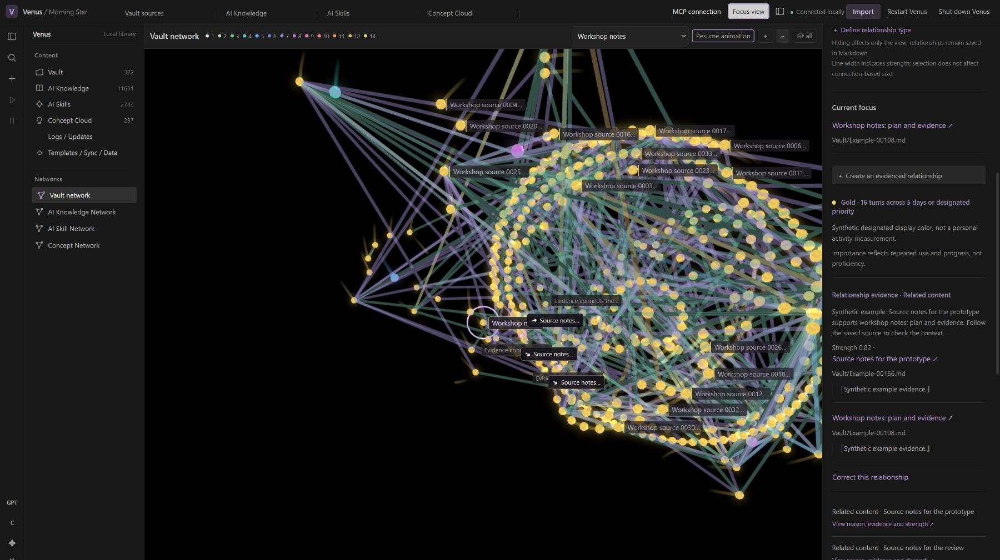

### AI Knowledge Network — follow an idea back to evidence

This close-up is inside the 11,651-item knowledge layer. **Compare evidence before a decision** is selected, with arrows to connected ideas. The sidebar explains the example procedure relationship, strength and quotation. Only that relationship type is displayed to keep the local path readable. Follow a connected idea, check the source, or open the full knowledge page.

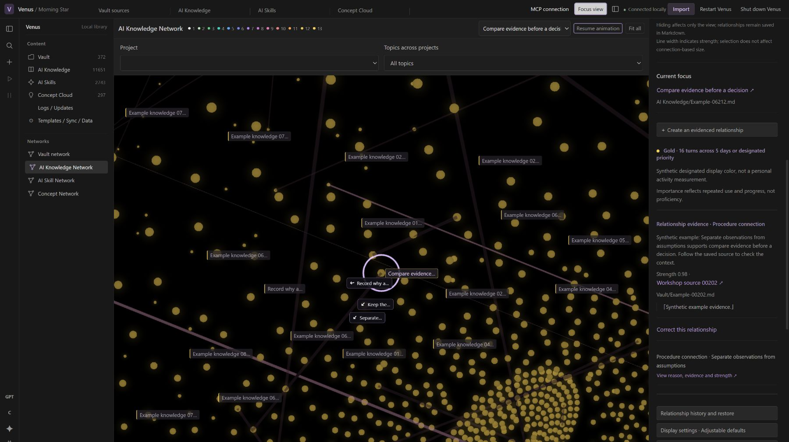

### AI Skill Network — connect methods and prerequisites

**Evidence-first review workflow** connects to reading the brief, checking claims and returning a checklist. The right sidebar shows the example relationship's reason and supporting knowledge. Follow a neighboring method, then open its complete Prompt to adapt it. This shows method relationships, not a proficiency certificate.

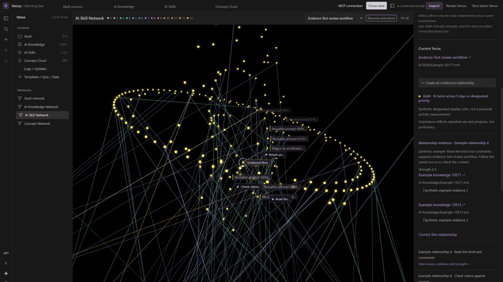

### Concept Network — see the larger topic structure

This separate network shows concept domains and themes. Use **Main domains** or **Locate any node…** to focus a theme, then double-click a concept to read its topic page. Relationship controls at the right choose what is displayed. A conceptual connection provides a reading route; its source and claim type still matter.

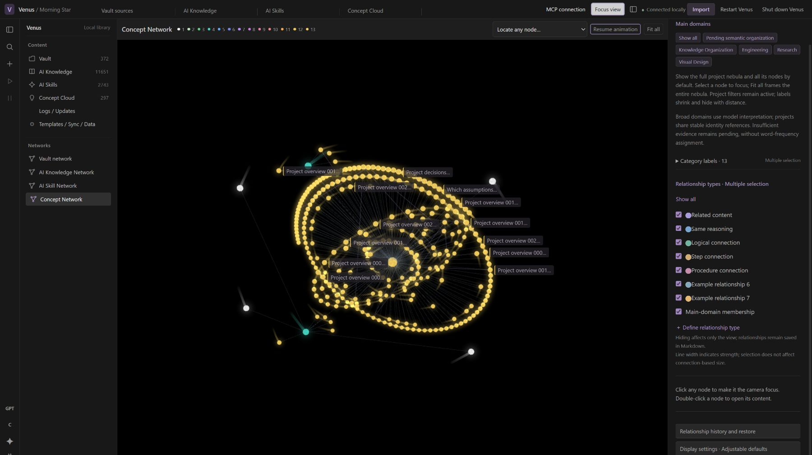

[Capture details and hashes](docs/images/0.8.0/capture-receipt.json) · [Page tour](docs/PAGE-TOUR.md) · [Four-layer examples](docs/FOUR-LAYERS.md)

## Use the library with your AI

With Venus running, query saved knowledge from the project directory:

```powershell
node codex-plugin/query.mjs "Example"
```

For a local tool-capable AI host, configure **`node codex-plugin/readonly-mcp.mjs`** as a stdio MCP server, using an absolute path for your installation. `VENUS_URL` selects your local address. Six read tools cover search, node reading, neighbors, sources, source fragments and handoff reading. The compact CLI reads bounded candidates and references; read queries do not reanalyze the archive.

Existing AI connection entries provide visual status/highlight feedback when a supported local connection is detected. **Connected locally** in these screenshots means browser-to-Venus connectivity; it does not assert an authenticated model in the fixture. A detected AI connection also does not prove a particular chat invoked retrieval or used its results. The caller must actually call the tools and include the returned context in its request.

See [integrations and provider scope](docs/INTEGRATIONS.md). A remote/cloud chat cannot reach your computer's loopback address automatically; optional remote access needs its own supported route and authorization.

## Practical questions

**Is Venus an AI, or a tool for my AI?**

It is a knowledge tool. The chosen analyzer understands supplied material; Venus preserves, presents, edits and retrieves results. Without an analyzer, existing data remains readable and editable. No particular code editor is required.

**Can it collect all my conversations?**

Only import material you can actually access or export. Conversion preserves supplied text and references; inaccessible history and binary attachments can leave gaps. Explicitly configured local Markdown sources can update incrementally. No private database, daily collection schedule or authorization to read internal session logs is shipped.

**Do I need a chat to keep telling it to continue?**

No. Configured, enabled work continues inside the running service. A pause, stopped service, missing access or unresolved error can stop progress. Resume the saved workflow and inspect the actual processing state rather than repeatedly starting another job.

**Can I choose another AI or use a local model?**

The provider form includes Codex CLI, compatible HTTP, Gemini Interactions and local compatible HTTP adapters. Use a model/service that meets the required contract. Adapter tests do not establish live Gemini access or compatibility with every local model. The main classification executor separately validates its supported model contract; saving provider settings does not silently change that executor or an active request.

**Does this train my AI or give it permanent memory?**

It supplies persistent external context. An authorized host can retrieve project history, decisions and evidence across tasks, reducing repeated explanation. It does not update model weights or automatically connect every chat. Check the actual retrieval call and sources to establish that context was used.

**How do Skills differ from Knowledge and Concepts?**

Knowledge explains what a source supports. Skills assemble usable methods or complete Prompts: common settings, criteria, variations, steps and boundaries. Concepts provide a readable synthesis of decisions, ideas and open questions. A mentioned method is not automatically an endorsed capability.

**Can I correct content, projects and templates?**

Yes: use the editor, classification controls and **Templates / Sync / Data**. Projects share stable identity across domains. Confirmed layer templates affect corresponding later requests; existing results require an explicit reanalysis scope. Manual choices and old versions remain traceable. This is controlled configuration and bounded maintenance, not unlimited self-modification.

**What do colors and sizes mean?**

The 13-color legend describes substantive use and continued discussion, with designated priorities where configured. It is not raw keyword frequency or proof of mastery. These captures use synthetic color metadata. Selection, relationship strength and display parameters are separate controls.

**Can multiple AI tools use one library?**

Compatible, individually authorized retrieval clients can consult the same saved context while Venus runs. This is not a public multi-user sharing service. Authorization for one provider does not authorize all others to receive your material.

**Do I need a paid API or a specific operating system?**

Local reading and retrieval require no paid model call. Analysis needs your own usable CLI sign-in, API or compatible local service. Windows is the tested launch path; macOS/Linux native operation is not certified. Source and launchers are provided, not a universal installer.

## Usage and privacy

> [!WARNING]
> Long histories and contexts can consume substantial subscription allowance or incur API charges. Choose your model and reasoning settings, start with a small sample and monitor your budget. Local models still need hardware and time. If you currently have extra Codex allowance, it can be a useful window for organizing a backlog; no universal promotion or expiry date is promised here.

Keep data and backups private. A configured cloud analyzer receives relevant analysis input; an authorized retrieval host receives requested results. The author does not need your library. Summaries and assignments can be wrong: follow sources and retain uncertainty. [Privacy and data flow](docs/PRIVACY.md) · [Network behavior](NETWORK-BEHAVIOR.md) · [Security](SECURITY.md)

## Validation and license

Build/test receipts and screenshot presentation checks serve different purposes. This tour is checked for actual controls, English text, privacy, image readability and complete README rendering. Neither passing tests nor synthetic screenshots establish whole-library quality. Older galleries are labeled in the [page tour](docs/PAGE-TOUR.md).

MIT licensed. [License](LICENSE) · [Third-party notices](THIRD-PARTY-NOTICES.md) · [Contributing](CONTRIBUTING.md) · [Changes](CHANGELOG.md)
