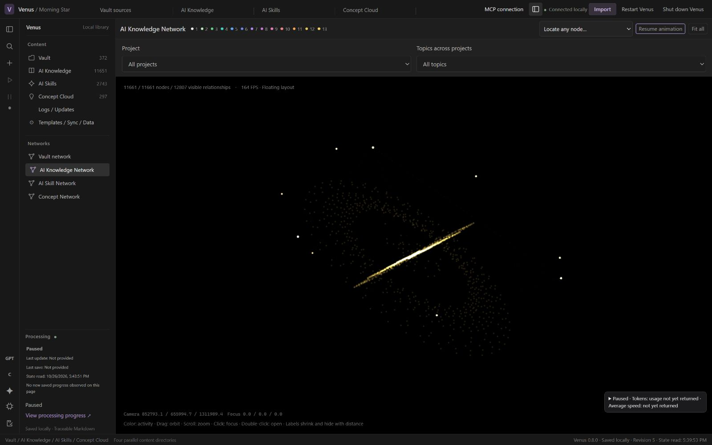

# Current English UI tour — 0.8.0

These are unedited 1600 × 1000 browser captures of the actual 0.8.0 application, not design mockups. The isolated fixture has 15,063 records (372 Vault, 11,651 knowledge, 2,743 skills and 297 concepts). Text, names, labels and evidence are synthetic; network geometry and scale are anonymized. No private source text, original identifiers or configuration is included.

Processing is disabled in this fixture. The displayed classifications are precomputed examples, not live model output. No model requests were made for these captures. Network animation is paused; the displayed FPS is not a performance benchmark. Counts describe this demonstration, not completed processing of a real library.

## Knowledge network

## Domain → project → content

## Original source

## Knowledge content

## Reusable skill Prompt

The editor shows the complete Prompt structure; lower sections can be read by scrolling. The method reference remains explicitly unconfirmed.

## Concept reading

## Explicit import

The English file button opens the real file input. No source was imported for this capture. Visible text and controls in these seven views were checked; this is not a claim that every application state has been audited in English.

[Capture receipt](images/0.8.0/capture-receipt.json) · [English introduction](../README.md) · [中文简介](README-zh.md)

Older galleries, including [0.6.0](SCREENSHOTS-0.6.0.md), are historical.
